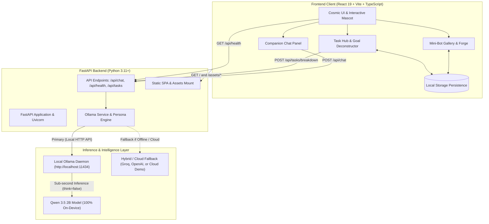
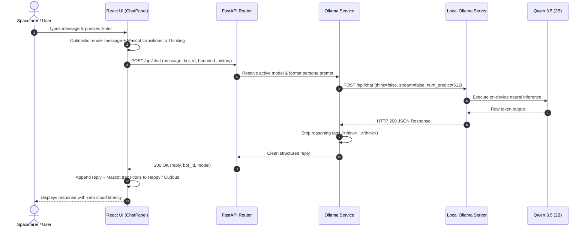

# MIMO — Personal Local AI Companion

[](https://mimo-roo2.onrender.com/)
[](https://github.com/Sivasakthi-Vengatesan/mimo)

🚀 **Live Application Link**: [https://mimo-roo2.onrender.com/](https://mimo-roo2.onrender.com/)

> *"Your personal on-device AI companion in a calm cosmic world. Chat, create assistants, and manage tasks with 100% local privacy."*

MIMO has been completely redesigned with a soft-cosmic aesthetic, deliberate typography, and a clean, uncluttered visual hierarchy. Powered on-device by local Ollama inference (`qwen3.5:2b`), MIMO provides real conversational intelligence, goal breakdown, and custom persona creation without cloud dependencies or subscriptions.

---

## 🎨 Visual Design System

- **Space ink (`#101827`)**: Deep dark foundation providing calm contrast.
- **Starlight (`#F5F2ED`)**: Primary text color for optimal legibility.
- **Nebula aqua (`#B1E5E6`)**: Primary secondary accent for badges, borders, and active highlights.
- **Signal lime (`#D8FF70`)**: Reserved for key actions and real-time live engine indicators.
- **Coral (`#F29191`) & Soft pink (`#F7ADAD`)**: Mascot warmth, high priority flags, and assistant traits.
- **Ice mint (`#CBFAFA`)**: Fresh secondary indicator for productivity states.
- **Typography**: **Plus Jakarta Sans** for display headings, **Inter** for comfortable body text, and **JetBrains Mono** for technical tags.

---

## 🌟 Key Application Experiences

### 1. Overview / Home Hub
- **Unified Composition**: Clean headline, concise description, primary CTA (*"Open Companion Chat"*), and secondary CTA (*"Explore Mini-Bots"*).
- **Single Interactive Mascot**: Vector SVG astronaut creature with reactive mood states (`idle`, `happy`, `thinking`, `curious`, `excited`, `sleepy`), clickable interactions, and dialogue quips.
- **Summary Cards**: Quick task progress, mini-bot launcher, and rotating daily insights.

### 2. Focused Companion Chat
- **Central Conversation Column**: Max-width ~760px optimized for comfortable reading.
- **Persistent Model Indicator**: Live local model badge (`qwen3.5:2b`) with 100% on-device guarantee.
- **Clean Input Controls**: Auto-expanding textarea with Enter to send, Shift+Enter for new lines, and responsive quick-starter chips.
- **Real-Time States**: Animated thinking indicator during inference, error notices with retry action, and clear conversation support.

### 3. Mini-Bot Creator & Gallery
- **3 Core Personas**:
  - **Study Buddy**: Academic revision, Feynman technique, practice quizzes.
  - **Daily Planner**: Schedule architect, task prioritization, burnout prevention.
  - **Coding Pal**: Syntax explanations, bug debugging, software architectures.
- **Assistant Forge**: Clean creation and editing modal for custom bots, system instructions, role presets, and category filters.
- **Persistence**: Saved locally in browser `localStorage`.

### 4. Task Hub & AI Goal Deconstructor
- **Structured Task List**: Compact rows with checkboxes, priority badges (`high`, `medium`, `low`), due dates, inline editing, and deletion.
- **Progress Tracking**: Dynamic completion bar and active filters (`All`, `Active`, `Completed`).
- **AI Task Breakdown ("Break It Down")**: Enter any high-level goal (e.g. *"Study for machine learning exam"*), and local Qwen deconstructs it into actionable sub-tasks with priority tags.
- **Celebration Feedback**: Confetti celebrations on task completion with mascot mood shifts.

### 5. Settings & Privacy
- Custom spacefarer name, companion personality style, visor accent selection, real-time connection status check, and safe factory data reset.

---

## 🏗️ System Architecture



---

## 🔄 Interaction & Data Flow Diagrams

### 1. Companion Chat & Inference Flow



### 2. AI Goal Deconstructor ("Break It Down") Flow

```mermaid
flowchart LR
    Goal["High-Level Goal\n(e.g., 'Study for ML Exam')"] --> Modal["TaskBreakdownModal"]
    Modal --> API["POST /api/tasks/breakdown"]
    API --> SystemPrompt["System Prompt\n(JSON Schema Directive)"]
    SystemPrompt --> Engine["Ollama / Qwen 3.5 Inference"]
    Engine --> Parser["JSON Array Parser & Validator"]
    Parser --> Steps["Structured Sub-Tasks\n(Title, Description, Priority)"]
    Steps --> TaskBoard["Task Board & Confetti Celebration"]
```



---

## 🚀 Startup Commands (Windows PowerShell)

### Option 1: Unified Full-Stack Runner (Recommended)
```powershell
node start.js --port 8000
```
Visit **`http://localhost:8000/`** — serves both the production React UI and FastAPI backend on a single port connected to your local Ollama.

### Option 2: Development Mode (Hot Reload)

#### Backend
```powershell
cd backend
python -m uvicorn app.main:app --host 127.0.0.1 --port 8000 --reload
```

#### Frontend
```powershell
cd frontend
npm run dev -- --host 127.0.0.1 --port 5173
```
Visit **`http://127.0.0.1:5173/`** to interact with MIMO.

---

## 🌐 Live Cloud Deployment

- **Production URL**: [https://mimo-roo2.onrender.com/](https://mimo-roo2.onrender.com/)
- **Hosting Platform**: [Render](https://render.com/)
- **API Health Check**: [https://mimo-roo2.onrender.com/api/health](https://mimo-roo2.onrender.com/api/health)


